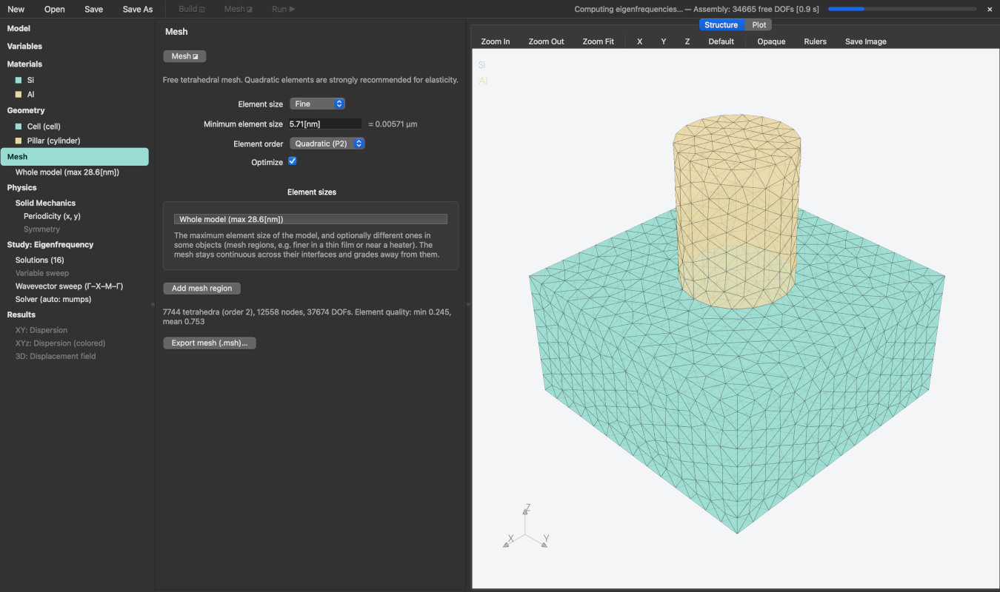

# SolidOcean

SolidOcean is a free and open-source finite element tool for 3D structures: phonon dispersion and
eigenfrequencies of periodic and finite structures, static and driven solid mechanics, and heat transfer.
A desktop interface takes a model from geometry and mesh to physics, study and results; every model is a
human-readable TOML file that can also be run headless from the command line, with variable sweeps.



## Installation

With [conda](https://conda-forge.org/download/), on macOS, Linux and Windows:

```bash
conda create -n solidocean -c conda-forge solidocean
conda activate solidocean
```

This also adds SolidOcean to the applications menu (macOS: `~/Applications`; conda creates it, mamba does not).
To work on the code instead, install the dependencies from conda-forge and SolidOcean from a clone:

```bash
git clone https://github.com/anufrievroman/solidocean.git
cd solidocean
conda env create -f environment.yml
conda activate solidocean
pip install -e . --no-deps
```

## Usage

```bash
solidocean                                # the interface (File → New offers ready-made models)
solidocean --template square slab.toml    # a new model file from a template
solidocean slab.toml                      # run it headless: CSV, NPZ and the model in slab/
solidocean --set "r=0.35*a" slab.toml     # override a variable from the command line
solidocean --install-app                  # macOS, installed from a clone: add SolidOcean.app to ~/Applications
```

Templates: `empty`, `bulk`, `membrane`, `beam`, `square`, `hexagonal`, `honeycomb`, `pillars`,
`cantilever`, `tensile`, `driven_beam` (solid mechanics); `heat_empty`, `heat_bar`, `heat_convection`,
`heat_pad`, `heat_radiation`, `heat_diode`, `heat_contact`, `heat_3omega`, `heat_fdtr` (heat transfer).
The model file format is described in [docs/input-format.md](docs/input-format.md).

## Physics

**Solid mechanics** with anisotropic elasticity, rotated crystal orientations and several bonded materials
(a library of Si, diamond, Ge, GaAs, 3C-SiC, 4H-SiC, Al, Au, Cr and SiO2, or your own):
- *Eigenfrequencies* and mode shapes; in periodic structures (square, rectangular, hexagonal or custom
  lattices) phonon dispersion along wavevector paths, with Bloch-periodic and symmetry boundaries.
- *Stationary*: displacement, strain, stress and von Mises stress under fixed or prescribed displacements
  and boundary loads (force per area, total force, pressure).
- *Frequency domain*: the driven response to oscillating loads or displacements, with loss factors and
  absorbing regions, e.g. the transmission of waves through a phononic structure.

**Heat transfer** (Fourier conduction) with anisotropic and temperature-dependent properties:
- *Stationary* and *transient*: fixed temperature, heat flux, convection and radiation boundaries, volume
  heat sources with rectangular, Gaussian or repeated pulses and spatial profiles such as a Gaussian beam,
  thermal boundary resistances and thin resistive layers at interfaces.
- *Frequency domain*: the temperature oscillation driven at one frequency, as in the 3ω and FDTR
  methods.

Any variable of a model (a dimension, a material property, a frequency) can be swept, and results are
evaluated with expressions of the fields. Boundary conditions apply to faces of the model or of one object,
optionally only inside a box. Geometry is built from blocks, cylinders, cones, spheres, prisms and lattice
cells (added or subtracted, rotated, arrayed) and meshed with linear or quadratic tetrahedra, finer where
needed.

## Validation

[docs/validation.md](docs/validation.md) compares SolidOcean with exact solutions, including mesh and
time-step convergence: Lamb waves in a plate, the vibrations of a free sphere, cantilever modes against beam
theories, the resonances of a driven bar with losses, Lamé's thick-walled cylinder, a semi-infinite solid
heated by a flux, the spreading resistance of a disk heater, boundary resistances in a layer stack, and the
3ω and FDTR responses. Regenerate it with `python validation/run.py`; the code tests run with `pytest`.

## Disclaimer

SolidOcean is an independent project. It is a graphical interface to open-source tools that already exist
(listed below), uniting their workflow, from geometry to results, under one roof as a lab tool for academic
research. It is provided as is, without any warranty; check the results of your models against known
solutions before relying on them.

## License

Copyright (C) 2026 Anufriev Roman.

SolidOcean is free software: you can redistribute it and/or modify it under the terms of the
GNU General Public License as published by the Free Software Foundation, either version 3 of the
License, or (at your option) any later version. It is distributed in the hope that it will be
useful, but WITHOUT ANY WARRANTY; see [LICENSE](LICENSE) for the full text.

SolidOcean builds mainly on these open-source projects, each under its own license:

| Project | Used for | License |
|---|---|---|
| [Gmsh](https://gmsh.info) | geometry and meshing | GPL-2.0-or-later |
| [MUMPS](https://mumps-solver.org) | sparse direct solver | CeCILL-C |
| [NumPy](https://numpy.org) | arrays and assembly | BSD-3-Clause |
| [SciPy](https://scipy.org) | sparse matrices and eigensolver | BSD-3-Clause |
| [Matplotlib](https://matplotlib.org) | plots | Matplotlib license (PSF-based) |
| [Qt for Python (PySide6)](https://doc.qt.io/qtforpython/) | interface | LGPL-3.0 |
| [PyVista](https://pyvista.org) and [VTK](https://vtk.org) | 3D views | MIT, BSD-3-Clause |
